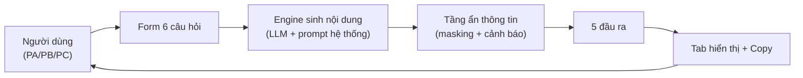

# SRS — Case Study Builder

| Thuộc tính | Giá trị |
|---|---|
| **Tài liệu** | Software Requirements Specification (SRS) |
| **Phiên bản** | 1.0 |
| **Trạng thái** | Draft — chờ phê duyệt |
| **Ngày** | 2026-10-13 |
| **Liên kết** | BRD v1.0 (docs/01-BRD-CaseStudyBuilder.md) |
| **Phạm vi** | MVP (Phase 1) — Web app một trang trên nền tảng VibeFlow |

---

## 1. Tổng quan hệ thống

**Case Study Builder** là web app một trang cho phép người dùng nhập 6 câu trả lời có cấu trúc về một dự án, chọn ngôn ngữ đầu ra, và nhận về 5 đầu ra: bản tin nội bộ, post Teams, case study chuẩn khung, bản dịch JA/EN, và danh sách cảnh báo rủi ro thông tin. Hệ thống áp dụng nguyên tắc **ẩn thông tin nhạy cảm mặc định** và **không bịa số liệu**.

### 1.1. Mô hình kiến trúc logic (WHAT, không phải HOW)

### 1.2. Thuật ngữ

| Thuật ngữ | Định nghĩa |
|---|---|
| Phiên tạo (Session) | Một lần người dùng nhập 6 câu trả lời và nhận 5 đầu ra |
| Masking | Quá trình thay thế thông tin nhạy cảm bằng mô tả chung |
| Warning | Cảnh báo về rủi ro thông tin cần lead duyệt |
| Bản nháp (Draft) | Đầu ra chưa được phê duyệt; mặc định mọi đầu ra là bản nháp |

---

## 2. Yêu cầu chức năng (Functional Requirements)

### 2.1. Module FORM — Nhập liệu

#### FR-FORM-001: Form 6 câu hỏi có cấu trúc

**Priority**: Must Have | **Status**: Draft

**Description**: Hệ thống phải hiển thị form gồm đúng 6 trường câu hỏi: (1) mô tả dự án, (2) thách thức lớn nhất, (3) cách giải quyết, (4) kết quả có con số, (5) bài học/mẹo, (6) người hùng thầm lặng.

**Functional Requirements**:
- **FR-FORM-001.1**: Trường Q1 phải hiển thị gợi ý "lĩnh vực, không ghi tên khách hàng".
- **FR-FORM-001.2**: Các trường Q1, Q2, Q3 là bắt buộc; Q4, Q5, Q6 là tùy chọn.
- **FR-FORM-001.3**: Hệ thống phải chặn gửi form khi thiếu trường bắt buộc và hiển thị thông báo lỗi cụ thể.

**Acceptance Criteria**:
1. Khi người dùng bỏ trống Q1/Q2/Q3 và nhấn "Tạo câu chuyện", hệ thống hiển thị lỗi tại đúng trường thiếu và không tạo đầu ra.
2. Khi người dùng nhập đủ 6 trường, hệ thống cho phép gửi.

#### FR-FORM-002: Chọn ngôn ngữ đầu ra

**Priority**: Must Have | **Status**: Draft

**Description**: Hệ thống phải cung cấp checkbox chọn ngôn ngữ (VI/JA/EN). Mặc định chọn VI.

**Functional Requirements**:
- **FR-FORM-002.1**: Người dùng có thể chọn 1 hoặc nhiều ngôn ngữ.
- **FR-FORM-002.2**: Nếu chọn JA hoặc EN, hệ thống phải tạo bản dịch tương ứng trong đầu ra O4.
- **FR-FORM-002.3**: Nếu chỉ chọn VI, hệ thống không tạo bản dịch và ẩn tab bản dịch.

**Acceptance Criteria**:
1. Khi người dùng chọn VI+JA+EN, đầu ra O4 chứa đủ 2 bản dịch.
2. Khi người dùng chỉ chọn VI, tab "Bản dịch" không xuất hiện.

#### FR-FORM-003: Dự án mẫu (Demo data)

**Priority**: Must Have | **Status**: Draft

**Description**: Hệ thống phải cung cấp sẵn ít nhất 2 dự án mẫu để người dùng tải vào form bằng một thao tác.

**Acceptance Criteria**:
1. Khi người dùng chọn "Dự án mẫu 1", cả 6 trường được điền sẵn dữ liệu mẫu.
2. Dữ liệu mẫu không chứa tên khách hàng thật.

#### FR-FORM-004: Giới hạn độ dài đầu vào

**Priority**: Should Have | **Status**: Draft

**Description**: Mỗi trường câu trả lời phải giới hạn độ dài tối đa 500 ký tự để kiểm soát chi phí token và chất lượng đầu ra.

**Acceptance Criteria**:
1. Khi người dùng nhập quá 500 ký tự, hệ thống chặn và hiển thị bộ đếm ký tự.

### 2.2. Module GEN — Sinh nội dung

#### FR-GEN-001: Tạo 5 đầu ra từ một lần gửi

**Priority**: Must Have | **Status**: Draft

**Description**: Hệ thống phải tạo đồng thời 5 đầu ra: bản tin nội bộ (~300 từ), post Teams (≤ 280 ký tự + hashtag), case study khung Bối cảnh→Thách thức→Giải pháp→Kết quả, bản dịch JA/EN (nếu chọn), danh sách cảnh báo.

**Functional Requirements**:
- **FR-GEN-001.1**: Bản tin nội bộ phải có giọng kể chuyện, dùng thông tin từ 6 câu trả lời.
- **FR-GEN-001.2**: Post Teams phải ≤ 280 ký tự (không tính hashtag) và kèm ít nhất 1 hashtag (#ProjectStory, #FJP…).
- **FR-GEN-001.3**: Case study phải có đúng 4 mục: Bối cảnh, Thách thức, Giải pháp, Kết quả.
- **FR-GEN-001.4**: Danh sách cảnh báo phải luôn được tạo, kể cả khi không phát hiện rủi ro (ghi "Đã rà soát — không phát hiện rủi ro").

**Acceptance Criteria**:
1. Khi gửi form hợp lệ, hệ thống trả về đủ 5 đầu ra trong thời gian ≤ 45 giây.
2. Mỗi đầu ra phải được sinh từ dữ liệu đầu vào, không chứa thông tin ngoài phạm vi đầu vào.

#### FR-GEN-002: Không bịa số liệu (No-hallucination)

**Priority**: Must Have | **Status**: Draft

**Description**: Hệ thống phải chỉ dùng thông tin người dùng cung cấp. Nếu trường Q4 (kết quả có con số) trống, hệ thống phải ghi cảnh báo "Nên bổ sung con số cụ thể" và KHÔNG tự tạo số liệu.

**Acceptance Criteria**:
1. Khi Q4 trống, đầu ra case study mục Kết quả không chứa bất kỳ con số nào do hệ thống tự sinh.
2. Khi Q4 trống, danh sách cảnh báo chứa mục "Nên bổ sung con số cụ thể".

#### FR-GEN-003: Ẩn thông tin nhạy cảm (Masking)

**Priority**: Must Have | **Status**: Draft

**Description**: Hệ thống phải phát hiện và thay thế tên khách hàng, tên sản phẩm, tên dự án, số liệu mật bằng mô tả chung (ví dụ: "khách hàng Nhật Bản", "hệ thống giao diện ô tô"). Mọi phát hiện phải được liệt kê trong danh sách cảnh báo.

**Functional Requirements**:
- **FR-GEN-003.1**: Tên riêng (công ty, con người) trong đầu vào phải được thay bằng mô tả vai trò/chung.
- **FR-GEN-003.2**: Cảnh báo phải chỉ rõ vị trí rủi ro (ví dụ: "tên dự án hoặc tên khách hàng có thể bị lộ qua mô tả kỹ thuật, cần lead duyệt").
- **FR-GEN-003.3**: Hệ thống không được sử dụng tên thật trong bất kỳ đầu ra nào.

**Acceptance Criteria**:
1. Khi đầu vào chứa tên công ty "ABC Corp", mọi đầu ra dùng "khách hàng" hoặc mô tả chung, không xuất hiện "ABC Corp".
2. Cảnh báo liệt kê đúng các điểm đã ẩn.

#### FR-GEN-004: Prompt hệ thống chuẩn

**Priority**: Must Have | **Status**: Draft

**Description**: Hệ thống phải sử dụng prompt hệ thống đóng vai "chuyên viên truyền thông nội bộ hiểu kỹ thuật phần mềm, viết song ngữ Việt–Nhật" với các ràng buộc: chỉ dùng thông tin người dùng cung cấp, không bịa số liệu, thay mọi tên riêng bằng mô tả chung, trả về JSON có cấu trúc.

**Acceptance Criteria**:
1. Kết quả trả về phải parse được thành JSON gồm các khóa: `newsletter_vi`, `teams_post`, `case_study` (context, challenge, solution, result), `ja_version`, `en_version`, `warnings[]`.
2. Khi thiếu số liệu, `warnings[]` chứa chuỗi "Nên bổ sung con số cụ thể".

#### FR-GEN-005: Xử lý lỗi sinh nội dung

**Priority**: Should Have | **Status**: Draft

**Description**: Khi engine sinh nội dung thất bại (timeout, lỗi parse JSON), hệ thống phải hiển thị thông báo lỗi thân thiện và cho phép thử lại mà không mất dữ liệu form.

**Acceptance Criteria**:
1. Khi lỗi xảy ra, dữ liệu 6 trường vẫn còn nguyên trên form.
2. Người dùng nhấn "Thử lại" và hệ thống thực hiện lại quá trình tạo.

### 2.3. Module VIEW — Hiển thị & Tương tác

#### FR-VIEW-001: Hiển thị 5 tab kết quả

**Priority**: Must Have | **Status**: Draft

**Description**: Kết quả phải hiển thị theo tab: Bản tin nội bộ, Post Teams, Case study, Bản dịch, Cảnh báo. Tab Cảnh báo phải hiển thị nổi bật (màu cảnh báo) khi có rủi ro.

**Acceptance Criteria**:
1. Khi có cảnh báo rủi ro, tab "Cảnh báo" hiển thị badge số lượng.
2. Người dùng chuyển đổi giữa các tab không làm mất nội dung đã chỉnh sửa.

#### FR-VIEW-002: Chỉnh sửa trực tiếp

**Priority**: Must Have | **Status**: Draft

**Description**: Mỗi đầu ra phải hiển thị trong vùng chỉnh sửa được (textarea/rich editor) để người dùng sửa trước khi copy.

**Acceptance Criteria**:
1. Người dùng sửa nội dung tab Bản tin, chuyển tab khác rồi quay lại, nội dung đã sửa vẫn còn.

#### FR-VIEW-003: Nút Copy

**Priority**: Must Have | **Status**: Draft

**Description**: Mỗi tab phải có nút "Copy" sao chép nội dung vào clipboard và hiển thị xác nhận thành công.

**Functional Requirements**:
- **FR-VIEW-003.1**: Nút Copy sao chép toàn bộ nội dung của tab đang mở.
- **FR-VIEW-003.2**: Sau khi copy, hiển thị thông báo "Đã sao chép" trong 2 giây.

**Acceptance Criteria**:
1. Khi nhấn Copy, clipboard chứa đúng nội dung hiển thị trên tab (kể cả sau khi đã chỉnh sửa).

#### FR-VIEW-004: Checkpoint xác nhận cảnh báo

**Priority**: Should Have | **Status**: Draft

**Description**: Trước khi copy từ tab Cảnh báo hoặc khi có cảnh báo mức cao, hệ thống phải yêu cầu xác nhận "Tôi đã đọc cảnh báo và chịu trách nhiệm rà soát".

**Acceptance Criteria**:
1. Khi có ≥ 1 cảnh báo mức cao, nút Copy trên tab Cảnh báo bị khóa cho đến khi tick xác nhận.

### 2.4. Module UI — Giao diện

#### FR-UI-001: Giao diện tông hồng–tím

**Priority**: Must Have | **Status**: Draft

**Description**: Giao diện phải sử dụng tông màu hồng–tím chủ đạo, thân thiện, responsive trên desktop và mobile.

**Acceptance Criteria**:
1. Giao diện hiển thị đúng trên viewport ≥ 360px mà không vỡ layout.
2. Màu chủ đạo thuộc dải hồng–tím (kiểm tra bằng mã màu trong stylesheet).

#### FR-UI-002: Trạng thái tải (Loading state)

**Priority**: Should Have | **Status**: Draft

**Description**: Trong lúc tạo nội dung, hệ thống phải hiển thị trạng thái tải rõ ràng để người dùng biết quá trình đang chạy.

**Acceptance Criteria**:
1. Khi nhấn "Tạo câu chuyện", nút bị vô hiệu hóa và hiển thị spinner/thông báo "Đang tạo…".

---

## 3. Yêu cầu phi chức năng (Non-Functional Requirements)

### NFR-PERF-001: Thời gian phản hồi

**Priority**: Must Have

**Description**: Hệ thống phải hoàn tất việc tạo 5 đầu ra trong **≤ 45 giây** cho đầu vào ≤ 1500 ký tự tổng cộng (điều kiện mạng nội bộ bình thường).

**Acceptance Criteria**:
1. Đo bằng đồng hồ thực tế từ lúc nhấn "Tạo câu chuyện" đến khi tab kết quả hiển thị đầy đủ.

### NFR-PERF-002: Khả năng mở rộng

**Priority**: Should Have

**Description**: Hệ thống phải xử lý được tối thiểu 20 phiên tạo đồng thời mà không làm tăng thời gian phản hồi trung bình quá 50%.

### NFR-SEC-001: Bảo mật dữ liệu đầu vào

**Priority**: Must Have

**Description**: Dữ liệu đầu vào (6 câu trả lời) không được lưu trữ lâu dài ngoài phiên làm việc; nếu lưu để tái sử dụng (Phase 2), phải có cơ chế xóa theo yêu cầu (quyền xóa dữ liệu theo PDPA Nghị định 13/2023/NĐ-CP).

**Acceptance Criteria**:
1. Kiểm tra: sau khi đóng phiên, không còn bản ghi đầu vào trên client storage.

### NFR-SEC-002: Kiểm soát thông tin nhạy cảm

**Priority**: Must Have

**Description**: Hệ thống phải đảm bảo không có tên khách hàng thật trong bất kỳ đầu ra nào (tham chiếu FR-GEN-003). Việc rà soát phải tuân theo nguyên tắc privacy-by-default.

### NFR-COMP-001: Tuân thủ quy định

**Priority**: Should Have

**Description**: Hệ thống phải tuân thủ: PDPA (VN – Nghị định 13/2023/NĐ-CP), APPI (JP) khi xử lý dữ liệu người dùng Nhật, và WCAG 2.1 AA cho giao diện.

**Acceptance Criteria**:
1. Form có nhãn (label) đầy đủ cho từng trường (WCAG).
2. Có thông báo mục đích xử lý dữ liệu khi người dùng nhập liệu lần đầu (PDPA).

### NFR-USAB-001: Tính dễ sử dụng

**Priority**: Must Have

**Description**: Người dùng mới không cần đào tạo có thể hoàn thành phiên tạo nội dung trong **≤ 10 phút** (bao gồm nhập liệu).

**Acceptance Criteria**:
1. Test usability với 5 người dùng mới: 100% hoàn thành, thời gian trung bình ≤ 10 phút.

### NFR-USAB-002: Khả năng tiếp cận (Accessibility)

**Priority**: Should Have

**Description**: Giao diện phải đạt WCAG 2.1 AA: tương phản màu ≥ 4.5:1 cho văn bản, điều hướng bằng bàn phím, nhãn form đầy đủ.

### NFR-QUAL-001: Chất lượng nội dung

**Priority**: Must Have

**Description**: Ít nhất 90% đầu ra phải không chứa lỗi ngữ pháp tiếng Việt nghiêm trọng và giữ đúng nghĩa kỹ thuật so với đầu vào (đánh giá bằng rà soát mẫu).

### NFR-COST-001: Giới hạn chi phí vận hành

**Priority**: Should Have

**Description**: Chi phí token trung bình mỗi phiên tạo phải được kiểm soát bằng giới hạn độ dài đầu vào (FR-FORM-004) và prompt tối ưu. Mục tiêu: ≤ 8K token đầu vào + ≤ 4K token đầu ra mỗi phiên.

---

## 4. Ma trận ưu tiên tổng hợp (MoSCoW)

| Mức | ID |
|---|---|
| **Must Have** | FR-FORM-001, FR-FORM-002, FR-FORM-003, FR-GEN-001, FR-GEN-002, FR-GEN-003, FR-GEN-004, FR-VIEW-001, FR-VIEW-002, FR-VIEW-003, FR-UI-001, NFR-PERF-001, NFR-SEC-001, NFR-SEC-002, NFR-USAB-001, NFR-QUAL-001 |
| **Should Have** | FR-FORM-004, FR-GEN-005, FR-VIEW-004, FR-UI-002, NFR-PERF-002, NFR-COMP-001, NFR-USAB-002, NFR-COST-001 |
| **Could Have** | BR-008 (log analytics), xuất file, kho lưu trữ |
| **Won't Have (MVP)** | Approval workflow đa cấp, SSO, tích hợp CMS, đa ngôn ngữ CN/KR |

---

## 5. Ngoài phạm vi MVP (Out of Scope)

- Quy trình phê duyệt đa cấp có lưu vết (Phase 2).
- Tự động phát hành nội dung ra kênh ngoài (Teams publish, CMS).
- Xuất file DOCX/PDF.
- Kho lưu trữ và tìm kiếm case study.
- Analytics hành vi người đọc.
- Phân quyền theo phòng ban / SSO.