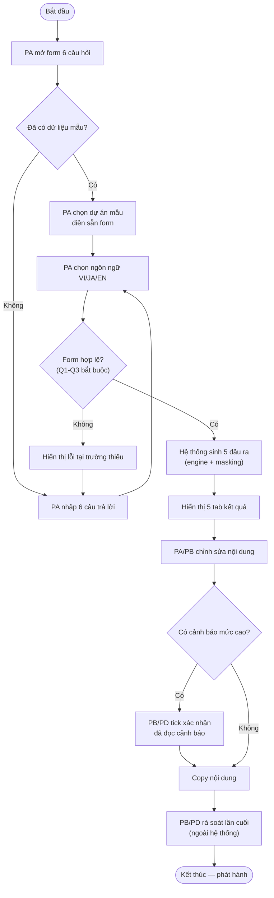
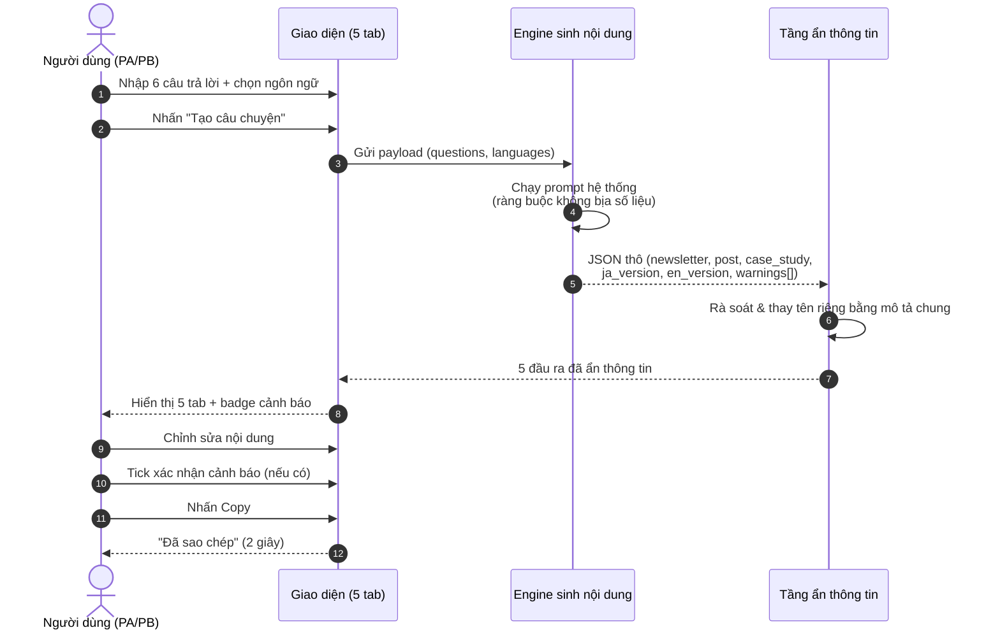
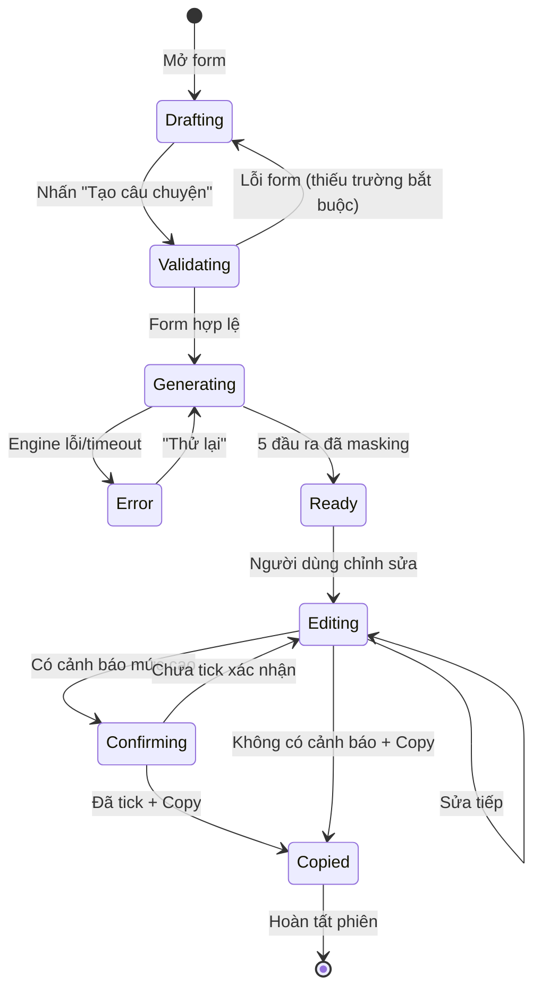
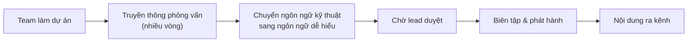
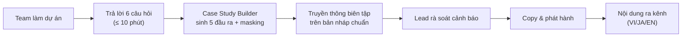
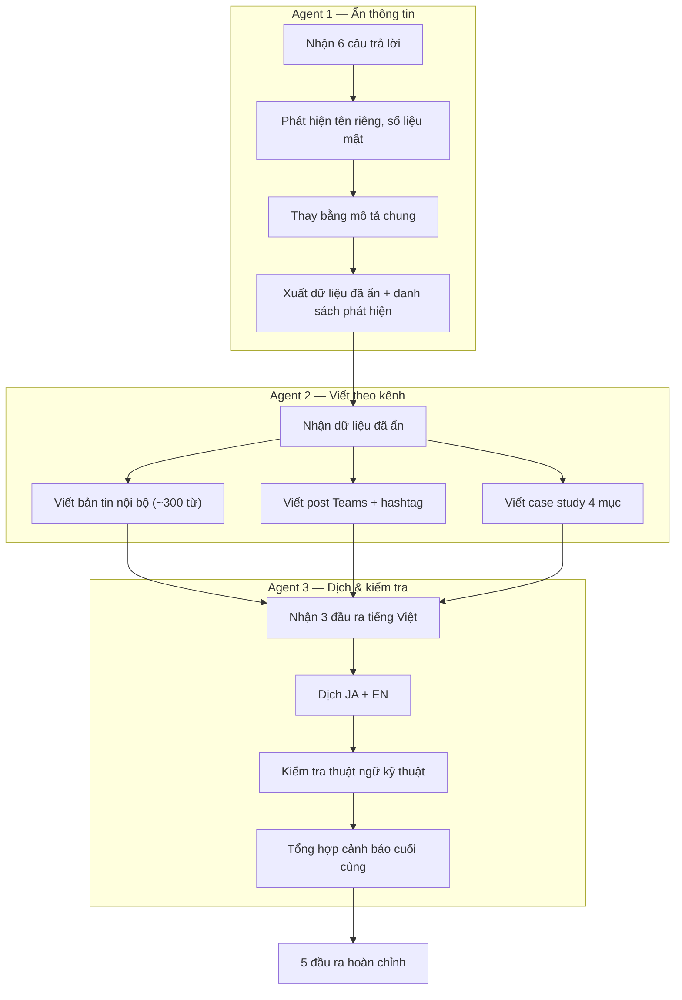

# Process Flows — Case Study Builder

| Thuộc tính | Giá trị |
|---|---|
| **Phiên bản** | 1.0 |
| **Trạng thái** | Draft |
| **Ký pháp** | BPMN mô tả dạng Mermaid (flowchart / sequenceDiagram / stateDiagram) |
| **Liên kết** | SRS v1.0, User Stories v1.0 |

---

## 1. Quy trình tổng thể: Tạo câu chuyện (End-to-End)

### Actors
- **PA**: Thành viên/lead dự án — người nhập liệu
- **Hệ thống**: Case Study Builder
- **PB**: Truyền thông nội bộ — người biên tập
- **PD**: Lead phê duyệt — người rà soát cảnh báo

### Flow

### Business Rules
- BR-001: Q1–Q3 bắt buộc; thiếu trường → chặn gửi.
- BR-002: Mọi đầu ra là bản nháp; không có bước tự động phát hành.
- BR-003: Copy bị khóa khi có cảnh báo mức cao chưa xác nhận.

### Exceptions
- **EX-01 — Lỗi engine**: Hiển thị thông báo lỗi, giữ nguyên dữ liệu form, cho phép "Thử lại" (FR-GEN-005).
- **EX-02 — Timeout > 45 giây**: Hiển thị cảnh báo chậm, không hủy dữ liệu đã nhập.

---

## 2. Sequence Diagram: Luồng tương tác hệ thống

### Business Rules
- BR-004: Prompt hệ thống trả về JSON đúng schema (FR-GEN-004).
- BR-005: Tầng masking chạy trước khi hiển thị, không chạy sau khi người dùng copy.

---

## 3. State Diagram: Vòng đời phiên tạo nội dung

### Business Rules
- BR-006: Trạng thái `Ready` chỉ đạt được sau khi hoàn tất masking.
- BR-007: Trạng thái `Copied` yêu cầu xác nhận cảnh báo nếu có rủi ro mức cao.

---

## 4. Quy trình hiện tại vs. Quy trình đề xuất (To-Be)

### 4.1. As-Is (hiện trạng) — sản xuất nội dung thủ công

**Điểm đau**: Phỏng vấn nhiều vòng, chu kỳ 4–8 giờ/bài, tỷ lệ làm lại ~40%, rủi ro lộ thông tin.

### 4.2. To-Be (đề xuất) — sản xuất có hỗ trợ AI

**Cải thiện**: Chu kỳ ≤ 10 phút cho bản nháp đầu, thông tin kỹ thuật chính xác, ẩn thông tin tự động, đa ngôn ngữ sẵn sàng.

---

## 5. Quy trình nâng cao (Phase 2): Workflow 3 agent

> Áp dụng khi triển khai tab Workflow trên VibeFlow — ghép 3 agent chuyên biệt.

### Business Rules
- BR-008: Agent 1 phải hoàn thành trước Agent 2 (dữ liệu đã ẩn mới được đưa vào viết).
- BR-009: Agent 3 kiểm tra thuật ngữ kỹ thuật trong bản dịch; phát hiện sai lệch → thêm vào cảnh báo.

---

## 6. Ma trận quy trình ↔ yêu cầu

| Quy trình | Yêu cầu liên quan |
|---|---|
| Quy trình tổng thể (§1) | FR-FORM-001..004, FR-GEN-001..005, FR-VIEW-001..004 |
| Sequence tương tác (§2) | FR-GEN-004, FR-GEN-003, FR-VIEW-003 |
| State diagram (§3) | FR-GEN-005, FR-VIEW-004 |
| To-Be (§4.2) | BR-001, NFR-USAB-001 |
| Workflow 3 agent (§5) | BR-007, NFR-PERF-002 |