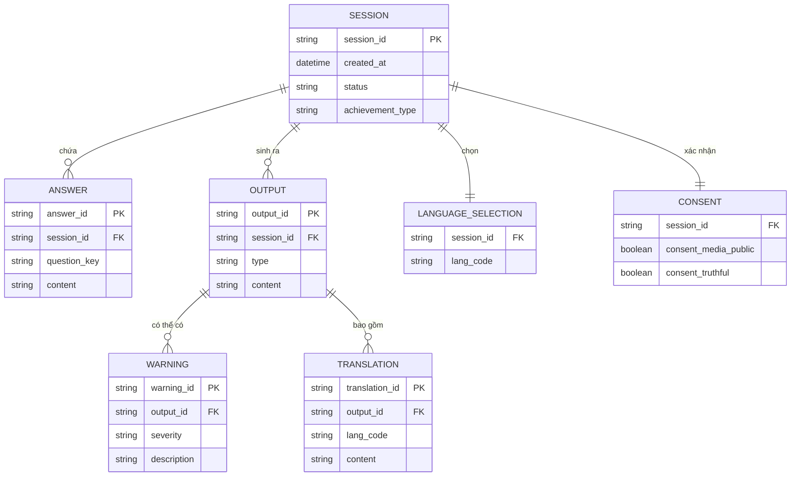

# Data Dictionary — Case Study Builder

| Thuộc tính | Giá trị |
|---|---|
| **Phiên bản** | 2.0 |
| **Trạng thái** | Draft |
| **Phạm vi** | Dữ liệu MVP (Phase 1) |
| **Liên kết** | SRS v2.0 |

---

## 1. Tổng quan thực thể



---

## 2. Bảng dữ liệu chi tiết

### 2.1. `SESSION` — Phiên tạo nội dung

| Thuộc tính | Kiểu dữ liệu | Bắt buộc | Mô tả | Ví dụ |
|---|---|---|---|---|
| `session_id` | String (UUID) | ✅ | Khóa chính của phiên | `ses_8f3a...` |
| `created_at` | Datetime | ✅ | Thời điểm bắt đầu phiên | `2026-10-13T09:30:00Z` |
| `status` | Enum | ✅ | Trạng thái phiên: `choosing_topic`, `drafting`, `consenting`, `validating`, `generating`, `ready`, `error`, `copied` | `ready` |
| `achievement_type` | Enum | ✅ | Chủ đề: `personal` | `team` | `personal` |
| `source` | Enum | ⬜ | Nguồn dữ liệu: `manual`, `sample_1`, `sample_2` | `sample_1` |

**Ghi chú**: Theo NFR-SEC-001, `SESSION` không được lưu lâu dài ngoài phiên làm việc ở MVP.

### 2.2. `ANSWER` — Câu trả lời đầu vào

| Thuộc tính | Kiểu dữ liệu | Bắt buộc | Mô tả | Ràng buộc |
|---|---|---|---|---|
| `answer_id` | String (UUID) | ✅ | Khóa chính | — |
| `session_id` | String (FK) | ✅ | Liên kết phiên | — |
| `question_key` | Enum | ✅ | Mã câu hỏi theo chủ đề (xem ma trận dưới) | `pa_context` |
| `content` | String | ✅ | Nội dung câu trả lời | ≤ 500 ký tự (FR-FORM-004) |

**Ma trận câu hỏi (2 chủ đề × 10 câu — nguồn chuẩn: docs/12 §2.2–2.3):**

**A. Thành tựu cá nhân (`achievement_type = personal`):**

| question_key | Câu hỏi hiển thị | Bắt buộc |
|---|---|---|
| `pa_context` | Bạn muốn chia sẻ thành tựu cá nhân nào? (1–2 câu) | ✅ |
| `pa_role` | Vai trò của bạn trong thành tựu này là gì? | ✅ |
| `pa_challenge` | Thách thức hoặc khó khăn lớn nhất bạn phải đối mặt là gì? | ✅ |
| `pa_action` | Bạn đã làm gì để vượt qua thách thức đó? | ✅ |
| `pa_result` | Kết quả đạt được có con số cụ thể nào không? | ⬜ |
| `pa_support` | Ai đã hỗ trợ hoặc đồng hành cùng bạn? | ⬜ |
| `pa_lesson` | Bài học hoặc kinh nghiệm bạn muốn chia sẻ? | ⬜ |
| `pa_impact` | Thành tựu này có ý nghĩa gì với team/công ty? | ⬜ |
| `pa_evidence` | Bạn có hình ảnh/minh chứng kèm theo không? | ⬜ |
| `pa_quote` | Bạn muốn trích dẫn một câu nói của chính mình không? | ⬜ |

**B. Thành tựu đội nhóm (`achievement_type = team`):**

| question_key | Câu hỏi hiển thị | Bắt buộc |
|---|---|---|
| `team_context` | Team của bạn đã đạt được thành tựu gì? (1–2 câu) | ✅ |
| `team_project` | Dự án/hoạt động này diễn ra trong bối cảnh nào? | ✅ |
| `team_challenge` | Thách thức lớn nhất của team là gì? | ✅ |
| `team_solution` | Team đã giải quyết bằng cách nào? | ✅ |
| `team_result` | Kết quả đạt được có con số cụ thể nào không? | ⬜ |
| `team_members` | Ai là những thành viên chủ chốt của team? | ⬜ |
| `team_collab` | Có sự phối hợp giữa các đơn vị/chi nhánh nào không? | ⬜ |
| `team_lesson` | Bài học hoặc cách làm hay muốn chia sẻ? | ⬜ |
| `team_impact` | Thành tựu này có ý nghĩa gì với khách hàng/công ty? | ⬜ |
| `team_quote` | Có câu nói nào của thành viên/leader muốn trích dẫn không? | ⬜ |

> **Lưu ý**: Các question_key cũ (`project_description`, `challenge`, `solution`, `result_metrics`, `lesson`, `unsung_hero`) **đã bị thay thế** bởi bộ câu hỏi mới (ADR-005).

### 2.3. `LANGUAGE_SELECTION` — Lựa chọn ngôn ngữ

| Thuộc tính | Kiểu dữ liệu | Bắt buộc | Mô tả | Ví dụ |
|---|---|---|---|---|
| `session_id` | String (FK) | ✅ | Liên kết phiên | — |
| `lang_code` | Enum | ✅ | Mã ngôn ngữ: `vi`, `ja`, `en` | `vi`, `ja` |

**Ràng buộc**: Ít nhất 1 ngôn ngữ; mặc định `vi` khi không chọn (FR-FORM-002.3).

### 2.4. `CONSENT` — Xác nhận bảo mật

| Thuộc tính | Kiểu dữ liệu | Bắt buộc | Mô tả |
|---|---|---|---|
| `session_id` | String (FK) | ✅ | Liên kết phiên |
| `consent_media_public` | Boolean | ✅ | Đồng ý hình ảnh/tài liệu đính kèm được phép sử dụng và đăng tải công khai |
| `consent_truthful` | Boolean | ✅ | Cam kết thông tin đúng sự thật và có sự đồng ý của khách hàng/người được nhắc tới |

**Ràng buộc**: Cả 2 bắt buộc = `true` trước khi gọi `generateStory` (FR-FORM-005, ADR-006).

### 2.5. `OUTPUT` — Đầu ra

| Thuộc tính | Kiểu dữ liệu | Bắt buộc | Mô tả |
|---|---|---|---|
| `output_id` | String (UUID) | ✅ | Khóa chính |
| `session_id` | String (FK) | ✅ | Liên kết phiên |
| `type` | Enum | ✅ | Loại đầu ra: `newsletter_vi`, `teams_post`, `case_study`, `translations`, `warnings` |
| `content` | Text | ✅ | Nội dung đầu ra (đã qua masking) |

**Cấu trúc `case_study` (FR-GEN-001.3):**

| Trường con | Mô tả |
|---|---|
| `context` | Bối cảnh dự án |
| `challenge` | Thách thức lớn nhất |
| `solution` | Cách team giải quyết |
| `result` | Kết quả đạt được |

### 2.6. `TRANSLATION` — Bản dịch

| Thuộc tính | Kiểu dữ liệu | Bắt buộc | Mô tả |
|---|---|---|---|
| `translation_id` | String (UUID) | ✅ | Khóa chính |
| `output_id` | String (FK) | ✅ | Liên kết đầu ra gốc |
| `lang_code` | Enum | ✅ | `ja` hoặc `en` |
| `content` | Text | ✅ | Nội dung bản dịch |

**Ràng buộc**: Chỉ tạo khi người dùng chọn JA/EN (FR-FORM-002.2).

### 2.7. `WARNING` — Cảnh báo

| Thuộc tính | Kiểu dữ liệu | Bắt buộc | Mô tả | Ví dụ |
|---|---|---|---|---|
| `warning_id` | String (UUID) | ✅ | Khóa chính | — |
| `output_id` | String (FK) | ✅ | Liên kết đầu ra | — |
| `severity` | Enum | ✅ | Mức độ: `high`, `medium`, `low`, `info` | `high` |
| `category` | Enum | ✅ | Loại rủi ro: `client_name`, `project_name`, `confidential_data`, `missing_metric`, `translation_check`, `proper_name`, `consent_missing`, `general` | `client_name` |
| `description` | Text | ✅ | Mô tả rủi ro + gợi ý xử lý | "Tên dự án hoặc tên khách hàng có thể bị lộ qua mô tả kỹ thuật, cần lead duyệt." |

**Danh mục cảnh báo chuẩn:**

| category | severity mặc định | Kích hoạt khi | Gợi ý xử lý |
|---|---|---|---|
| `client_name` | high | Phát hiện tên công ty/khách hàng | Thay bằng mô tả chung |
| `project_name` | high | Phát hiện tên dự án thật | Thay bằng mô tả chung |
| `confidential_data` | high | Số liệu mật, chi tiết hợp đồng | Bỏ hoặc ẩn; cần lead duyệt |
| `missing_metric` | medium | Q4 trống (pa_result/team_result) | Ghi "Nên bổ sung con số cụ thể" |
| `translation_check` | medium | Bản dịch có thuật ngữ nghi vấn | Kiểm tra thuật ngữ thủ công |
| `proper_name` | medium | Tên riêng (dự án/khách hàng/người) còn trong đầu ra | Đánh dấu nổi bật để rà soát; hoặc chuyển thành chữ cái đầu |
| `consent_missing` | high | Nội dung evidence/đầu vào mà thiếu consent | Chặn tạo; yêu cầu tick checkbox |
| `general` | low | Rủi ro khác | Rà soát thủ công |

---

## 3. Schema JSON đầu ra của prompt hệ thống (FR-GEN-004)

```json
{
  "newsletter_vi": "string — bản tin nội bộ ~300 từ, giọng FUN",
  "teams_post": "string — post Teams ≤ 280 ký tự + hashtag",
  "case_study": {
    "context": "string",
    "challenge": "string",
    "solution": "string",
    "result": "string"
  },
  "ja_version": "string — bản dịch tiếng Nhật",
  "en_version": "string — bản dịch tiếng Anh",
  "warnings": [
    {
      "severity": "high | medium | low | info",
      "category": "client_name | project_name | confidential_data | missing_metric | translation_check | proper_name | consent_missing | general",
      "description": "string"
    }
  ]
}
```

**Ràng buộc parse (FR-GEN-004.1)**:
- Mọi khóa bắt buộc phải tồn tại; thiếu khóa → coi là lỗi → FR-GEN-005.
- `warnings` luôn là mảng, có thể rỗng.

---

## 4. Dữ liệu mẫu (Demo — FR-FORM-003)

> Dữ liệu mẫu được viết lại theo cấu trúc 2 chủ đề × 10 câu (docs/12 §2).

### Dự án mẫu 1 — Thành tựu đội nhóm: Giao diện ô tô (khách Nhật)

| Trường | Giá trị |
|---|---|
| `achievement_type` | `team` |
| `team_context` | Team giao diện ô tô hoàn thành phase 1 vượt mong đợi, khách tin tưởng giao tiếp phase 2 |
| `team_project` | Dự án phần mềm giao diện ô tô cho khách hàng Nhật Bản |
| `team_challenge` | Áp dụng thiết kế mới mà không làm giảm hiệu năng |
| `team_solution` | Team đánh giá rủi ro trước và triển khai theo thứ tự ưu tiên |
| `team_result` | Giao hàng đúng hạn, khách đánh giá cao, giao tiếp phase 2 |
| `team_members` | PM và các key-member (viết tắt nếu là khách/người ngoài) |
| `team_collab` | Phối hợp offshore + onsite |
| `team_lesson` | Đánh giá rủi ro sớm giúp giảm sốc khi thay đổi thiết kế |
| `team_impact` | Củng cố niềm tin khách hàng, mở ra phase 3, 4 |
| `team_quote` | "Delivery tốt dự án sẽ tự đến" |

### Dự án mẫu 2 — Thành tựu đội nhóm: Đưa AI vào quy trình

| Trường | Giá trị |
|---|---|
| `achievement_type` | `team` |
| `team_context` | Đưa AI vào quy trình xử lý yêu cầu nội bộ, giảm 30% thời gian |
| `team_project` | Dự án nội bộ về tự động hóa xử lý yêu cầu |
| `team_challenge` | Nhân viên lo ngại độ chính xác và thay đổi quy trình |
| `team_solution` | Pilot trên 1 phòng ban, đo lường song song với quy trình cũ |
| `team_result` | Giảm 30% thời gian xử lý yêu cầu |
| `team_members` | Trưởng phòng pilot (viết tắt nếu cần) |
| `team_collab` | Phối hợp giữa phòng ban pilot và team phát triển |
| `team_lesson` | Bắt đầu nhỏ, đo lường rõ, mở rộng dần |
| `team_impact` | Nền tảng để nhân rộng AI toàn tổ chức |
| `team_quote` | — |

---

## 5. Thuật ngữ miền (Domain Glossary)

| Thuật ngữ | Định nghĩa | Nguồn |
|---|---|---|
| Case study | Bài viết mô tả một dự án theo khung Bối cảnh → Thách thức → Giải pháp → Kết quả | BRD |
| Masking | Thay thế thông tin nhạy cảm bằng mô tả chung | BRD §4.5 |
| Proper-name highlight | Đánh dấu nổi bật tên riêng trong bản nháp để người chỉnh sửa rà soát | BRD §4.5 |
| Initialization | Thay tên đầy đủ bằng chữ cái đầu (Takenaka → T.) | BRD §4.5 |
| Consent | Xác nhận bắt buộc về quyền công khai hình ảnh + tính xác thực/đồng ý | BRD §4.5 |
| Bản nháp (Draft) | Đầu ra chưa phê duyệt, mặc định của mọi đầu ra | BRD §4.5 |
| FJP | Đối tác/tổ chức Nhật Bản của công ty | BRD |
| FUN | Bản tin nội bộ FPT Japan — chuẩn giọng văn đầu ra | docs/12 §5 |
| PDPA | Nghị định 13/2023/NĐ-CP về bảo vệ dữ liệu cá nhân (VN) | BRD §9 |
| APPI | Act on the Protection of Personal Information (JP) | BRD §9 |
| Hashtag | Thẻ phân loại nội dung trên mạng xã hội/Teams | SRS FR-GEN-001.2 |