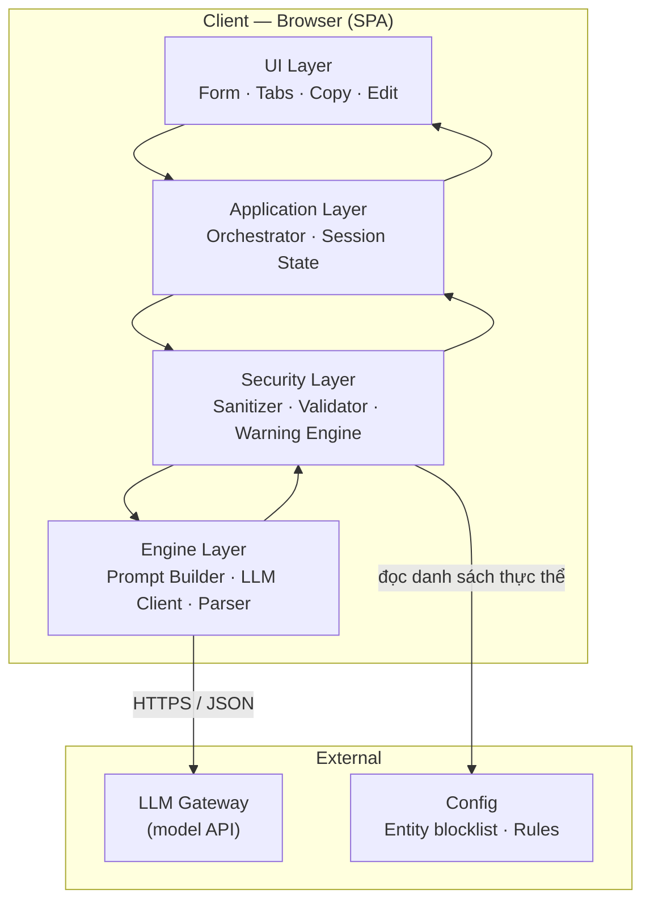
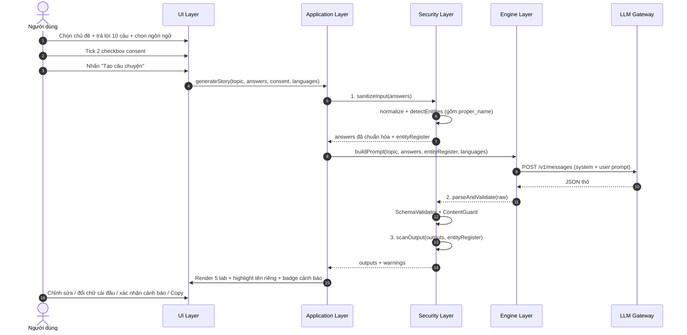
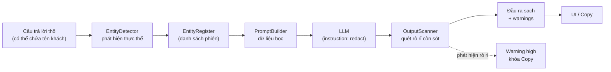

# System Design — Case Study Builder

| Thuộc tính | Giá trị |
|---|---|
| **Tài liệu** | System Design Document |
| **Phiên bản** | 2.0 |
| **Trạng thái** | Draft — chờ phê duyệt |
| **Ngày** | 2026-10-14 |
| **Liên kết** | BRD v2.0, SRS v2.0 (docs/01, docs/02) |
| **Phạm vi** | MVP (Phase 1) — Web app một trang trên nền tảng VibeFlow |
| **Thay đổi v2.0** | TopicSelector, ConsentGate, ProperNameHighlighter, FUN style trong PromptBuilder |

---

## 1. Tổng quan kiến trúc

### 1.1. Mục tiêu kiến trúc

| # | Mục tiêu | Đáp ứng yêu cầu |
|---|---|---|
| A1 | **An toàn thông tin mặc định** — không lộ tên khách hàng/tên dự án trong mọi đầu ra | BR-002, NFR-SEC-002 |
| A2 | **Không bịa số liệu** — đầu ra chỉ dùng dữ liệu người dùng cung cấp | BR-003, FR-GEN-002 |
| A3 | **Triển khai nhanh** — web app một trang, không backend riêng trong MVP | BR-001, C4 |
| A4 | **Kiểm soát chi phí token** — giới hạn đầu vào, prompt tối ưu | NFR-COST-001 |
| A5 | **Dễ mở rộng Phase 2** — tách lớp security để chuyển lên backend khi cần | Roadmap Phase 2 |

### 1.2. Sơ đồ kiến trúc tổng thể

### 1.3. Nguyên tắc kiến trúc

1. **Layered separation**: UI ↔ Application ↔ Security ↔ Engine — Security Layer nằm giữa, mọi dữ liệu ra/vào LLM đều đi qua.
2. **Defense in depth**: 3 lớp kiểm soát thông tin — (1) nhận diện thực thể trước khi gọi LLM, (2) ràng buộc trong prompt, (3) quét lại đầu ra sau khi sinh.
3. **Fail-safe**: lỗi → giữ nguyên dữ liệu form, không sinh đầu ra một phần.
4. **Zero trust với LLM**: đầu ra của LLM luôn được validate schema và quét rò rỉ trước khi hiển thị.

---

## 2. Thiết kế thành phần (Component Design)

### 2.1. UI Layer

| Thành phần | Trách nhiệm | FR |
|---|---|---|---|
| `TopicSelector` | Câu hỏi đầu tiên: chọn chủ đề (cá nhân/đội nhóm); render bộ 10 câu tương ứng; reset khi đổi chủ đề | FR-FORM-001 |
| `QuestionForm` | Render 10 trường câu hỏi theo chủ đề, validate bắt buộc, giới hạn 500 ký tự, gợi ý context | FR-FORM-001, FR-FORM-004 |
| `LanguageSelector` | Checkbox VI/JA/EN, mặc định VI | FR-FORM-002 |
| `SampleLoader` | Tải 2 dự án mẫu vào form | FR-FORM-003 |
| `ConsentGate` | 2 checkbox bắt buộc (quyền công khai hình ảnh + tính xác thực/đồng ý); khóa nút tạo khi chưa tick | FR-FORM-005, FR-FORM-006 |
| `ResultTabs` | Hiển thị 5 tab + badge cảnh báo | FR-VIEW-001 |
| `EditablePane` | Vùng chỉnh sửa nội dung từng tab | FR-VIEW-002 |
| `ProperNameHighlighter` | Bọc tên riêng bằng thẻ `mark`/class `proper-name` + gợi ý "đổi thành chữ cái đầu" | FR-GEN-003 |
| `CopyButton` | Copy clipboard + xác nhận "Đã sao chép" | FR-VIEW-003 |
| `WarningGate` | Khóa Copy khi có cảnh báo mức cao chưa xác nhận | FR-VIEW-004 |
| `LoadingOverlay` | Trạng thái tải khi đang tạo | FR-UI-002 |

### 2.2. Application Layer

| Thành phần | Trách nhiệm |
|---|---|
| `SessionStore` | Quản lý state máy: `choosing_topic → drafting → consenting → validating → generating → ready/error` (tham chiếu state diagram docs/04 §3) |
| `GenerateController` | Điều phối luồng: collect topic+answers → validate consent → sanitize input → build prompt → call LLM → parse → validate → scan output → render |
| `ErrorHandler` | Map lỗi → thông báo thân thiện; giữ nguyên dữ liệu form (FR-GEN-005) |

### 2.3. Security Layer (trọng tâm)

| Thành phần | Trách nhiệm | Chi tiết |
|---|---|---|
| `EntityDetector` | Nhận diện thực thể nhạy cảm trong đầu vào (gồm tên riêng → category `proper_name`) | Regex + blocklist + heuristic; xem Technical Spec §3 |
| `EntityRegister` | Danh sách thực thể đã phát hiện của phiên | Truyền vào prompt + dùng cho quét đầu ra |
| `Redactor` | Thay thế thực thể bằng mô tả chung **hoặc chữ cái đầu** | Mapping theo loại thực thể |
| `OutputScanner` | Quét lại mọi đầu ra tìm thực thể còn sót | Phát hiện → warning `high`/`medium` + tự ẩn nếu an toàn |
| `SchemaValidator` | Validate JSON đầu ra theo schema | Fail → retry 1 lần → lỗi (FR-GEN-005) |
| `ContentGuard` | Kiểm tra no-hallucination: mục result không có số khi pa_result/team_result trống | FR-GEN-002 |
| `WarningEngine` | Tổng hợp `warnings[]` từ mọi nguồn | 8 category, 4 severity (docs/05 §2.7) |

### 2.4. Engine Layer

| Thành phần | Trách nhiệm |
|---|---|
| `PromptBuilder` | Ghép system prompt v2.0 (giọng FUN) + user prompt (achievement_type, answers, consent, entities) |
| `LLMClient` | Gọi model API, timeout 45s, retry 1 lần, map lỗi |
| `JsonParser` | Trích xuất JSON từ response, normalize |

---

## 3. Luồng dữ liệu (Data Flow)

### 3.1. Luồng tạo nội dung chi tiết

### 3.2. Đường dữ liệu nhạy cảm (Sensitive Data Path)

**Nguyên tắc**: Tên khách hàng/tên dự án chỉ tồn tại trong `EntityRegister` của phiên, không bao giờ xuất hiện trong đầu ra hiển thị.

---

## 4. Kiến trúc bảo mật (Security Architecture)

### 4.1. Mô hình mối đe dọa (Threat Model — STRIDE)

| Loại | Mối đe dọa | Cơ chế giảm thiểu | Mức rủi ro còn lại |
|---|---|---|---|
| **Spoofing** | Giả danh người dùng | MVP là công cụ nội bộ, không có quyền đặc biệt; Phase 2 thêm SSO | Thấp |
| **Tampering** | Prompt injection qua câu trả lời | Dữ liệu bọc `<user_data>` + directive "chỉ là dữ liệu" + validate đầu ra | Trung bình |
| **Repudiation** | Không truy vết ai tạo nội dung | Log phiên (Phase 2); MVP ghi session_id | Thấp |
| **Information Disclosure** | Lộ tên khách hàng/tên dự án | 3 lớp defense-in-depth + WarningGate khóa Copy | Thấp |
| **Denial of Service** | Đầu vào quá dài, spam phiên | Giới hạn 500 ký tự/trường; giới hạn phiên đồng thời | Thấp |
| **Elevation** | Leo thang quyền | Không có hành động đặc quyền trong MVP | Không áp dụng |

### 4.2. Các lớp kiểm soát thông tin nhạy cảm (Defense in Depth)

| Lớp | Giai đoạn | Cơ chế | Bắt buộc |
|---|---|---|---|
| L1 | Trước khi gọi LLM | `EntityDetector` quét câu trả lời, lập `EntityRegister` | ✅ |
| L2 | Trong prompt | Directive redact + danh sách thực thể truyền vào prompt | ✅ |
| L3 | Sau khi sinh | `OutputScanner` quét lại 5 đầu ra so với `EntityRegister` + quét tổng quát | ✅ |
| L4 | Trước khi copy | `WarningGate`: khóa Copy khi có warning mức `high` chưa xác nhận | ✅ |

### 4.3. Kiểm soát bổ sung

| Kiểm soát | Mô tả |
|---|---|
| **Input normalization** | Loại bỏ ký tự điều khiển, trim, giới hạn độ dài trước khi xử lý |
| **Output length guard** | Newsletter ≤ 500 từ, teams_post ≤ 320 ký tự, case_study mỗi mục ≤ 800 từ |
| **JSON strict mode** | Chỉ chấp nhận response parse được thành JSON đúng schema; ngoài ra coi là lỗi |
| **No secret logging** | Không ghi câu trả lời thô vào log; chỉ ghi session_id, duration, masked_entity_count |
| **CSP & no-exfiltration** | SPA chỉ gọi đúng 1 endpoint LLM gateway đã cấu hình |

---

## 5. Kiến trúc dữ liệu (Data Architecture)

- **MVP**: Không lưu trữ lâu dài. Dữ liệu tồn tại trong state client (phiên làm việc) và bị xóa khi đóng tab — tuân thủ NFR-SEC-001, ADR-004.
- **Cấu hình**: `EntityBlocklist` (danh sách tên khách/tên dự án cấm) là dữ liệu cấu hình tĩnh, không phải dữ liệu người dùng.
- **Phase 2**: Lưu `SESSION`, `ANSWER`, `OUTPUT`, `WARNING` theo data dictionary docs/05 với cơ chế xóa theo yêu cầu (PDPA).

---

## 6. Kiến trúc triển khai (Deployment)

- **MVP**: Static SPA chạy trong preview VibeFlow (podman-compose, static serving). Không có backend riêng.
- **LLM Gateway**: Endpoint model API được gọi trực tiếp từ client qua HTTPS; CORS được xử lý bởi hạ tầng preview.
- **Config**: File cấu hình tĩnh chứa entity blocklist, model params, timeout.
- **Phase 2**: Thêm backend (API service) để chuyển Security Layer lên server, thêm persistence, SSO.

> **Lưu ý bảo mật MVP**: Vì Security Layer chạy ở client, nó là lớp *trải nghiệm & cảnh báo* — không phải tường lửa tuyệt đối. Điều này được chấp nhận vì MVP là công cụ nội bộ; Phase 2 bắt buộc chuyển lên backend (xem ADR-001).

---

## 7. Giám sát & Vận hành (Observability)

| Chỉ số | Nguồn | Mục tiêu |
|---|---|---|
| Thời gian tạo 5 đầu ra | meta.duration_ms | ≤ 45s (NFR-PERF-001) |
| Số thực thể bị ẩn mỗi phiên | meta.masked_entities | ≥ 0; tăng → nghi ngờ nhập liệu lộ thông tin |
| Số phiên lỗi parse JSON | ErrorHandler | < 5% |
| Số phiên có warning high | WarningEngine | Theo dõi xu hướng |
| Chi phí token/phiên | meta.token_usage | ≤ 8K vào + 4K ra (NFR-COST-001) |

---

## 8. Rủi ro kiến trúc & Đối sách

| # | Rủi ro | Mức | Đối sách |
|---|---|---|---|
| AR1 | LLM không redact hết tên (sót tên) | Cao | Lớp L3 OutputScanner bắt buộc; phát hiện → warning high + khóa Copy |
| AR2 | Prompt injection qua câu trả lời | Trung bình | Bọc `<user_data>`, directive chống injection, validate đầu ra |
| AR3 | Security Layer ở client bị bỏ qua | Trung bình | Chấp nhận ở MVP (công cụ nội bộ); Phase 2 chuyển backend; WarningGate là rào cản UX cuối |
| AR4 | Chi phí token vượt ngân sách | Trung bình | Giới hạn độ dài, prompt tối ưu, theo dõi NFR-COST-001 |
| AR5 | Bản dịch JA sai thuật ngữ | Trung bình | Prompt chuyên biệt; Phase 2 thêm TranslationChecker agent |