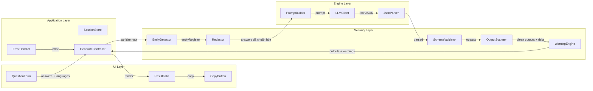
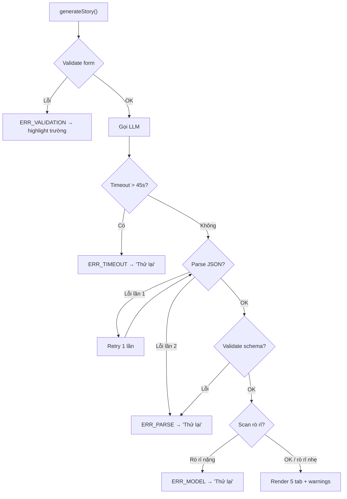

# API Contracts — Case Study Builder

| Thuộc tính | Giá trị |
|---|---|
| **Tài liệu** | API Contracts & Data Flow |
| **Phiên bản** | 1.0 |
| **Trạng thái** | Draft |
| **Liên kết** | SRS v1.0, System Design v1.0, ADR-003 |
| **Phạm vi** | MVP (Phase 1) — hợp đồng nội bộ giữa các lớp + hợp đồng LLM gateway |

---

## 1. Nguyên tắc chung

- **Định dạng**: JSON (UTF-8).
- **Versioning**: `Content-Type: application/json`; contract version trong field `contract_version`.
- **Encoding**: Unicode bình thường; không dùng escape đặc biệt.
- **Xử lý lỗi**: mọi lỗi trả về `{ "error": { "code": "...", "message": "...", "retryable": boolean } }`.
- **Không log**: nội dung `answers` không được ghi vào log (ADR-004).

---

## 2. Contract nội bộ: `generateStory`

> Hợp đồng giữa Application Layer và Security/Engine Layer (gọi nội bộ trong SPA).

### 2.1. Request

```json
{
  "contract_version": "1.0",
  "answers": {
    "project_description": "string ≤ 500 ký tự, bắt buộc",
    "challenge": "string ≤ 500 ký tự, bắt buộc",
    "solution": "string ≤ 500 ký tự, bắt buộc",
    "result_metrics": "string ≤ 500 ký tự | null",
    "lesson": "string ≤ 500 ký tự | null",
    "unsung_hero": "string ≤ 500 ký tự | null"
  },
  "languages": ["vi", "ja", "en"],
  "options": {
    "use_sample": "sample_1 | sample_2 | null"
  }
}
```

**Ràng buộc**:
- `languages` ⊆ {`vi`, `ja`, `en`}, không rỗng, mặc định `["vi"]`.
- `answers.project_description`, `challenge`, `solution` bắt buộc (FR-FORM-001.2).
- Tổng độ dài tất cả câu trả lời ≤ 2500 ký tự (kiểm soát token).

### 2.2. Response — Thành công (HTTP 200)

```json
{
  "contract_version": "1.0",
  "outputs": {
    "newsletter_vi": "string ~300 từ",
    "teams_post": "string ≤ 280 ký tự + hashtag",
    "case_study": {
      "context": "string",
      "challenge": "string",
      "solution": "string",
      "result": "string"
    },
    "translations": {
      "ja": "string | null",
      "en": "string | null"
    }
  },
  "warnings": [
    {
      "severity": "high | medium | low | info",
      "category": "client_name | project_name | confidential_data | missing_metric | translation_check | general",
      "description": "string"
    }
  ],
  "meta": {
    "session_id": "string (UUID)",
    "duration_ms": 1234,
    "masked_entities": 3,
    "token_usage": { "input": 2100, "output": 1850 },
    "prompt_version": "1.0"
  }
}
```

**Ràng buộc**:
- `outputs.translations.ja/en` = `null` khi ngôn ngữ tương ứng không được chọn.
- `warnings` luôn là mảng (có thể rỗng).
- `meta.masked_entities` = số thực thể bị ẩn trong phiên.

### 2.3. Response — Lỗi (HTTP 4xx/5xx)

| code | HTTP | retryable | Ý nghĩa | Hành động UI |
|---|---|---|---|---|
| `ERR_VALIDATION` | 422 | ❌ | Form không hợp lệ (thiếu trường, quá dài) | Hiển thị lỗi tại trường |
| `ERR_TIMEOUT` | 504 | ✅ | LLM vượt 45s | "Thử lại" |
| `ERR_PARSE` | 502 | ✅ | JSON response không parse được sau retry | "Thử lại" |
| `ERR_MODEL` | 503 | ✅ | Model API lỗi | "Thử lại" |
| `ERR_RATE_LIMIT` | 429 | ⏳ | Vượt giới hạn phiên đồng thời | Chờ + thử lại |

**Body lỗi**:
```json
{
  "error": {
    "code": "ERR_TIMEOUT",
    "message": "Quá trình tạo nội dung chưa hoàn tất trong thời gian cho phép.",
    "retryable": true
  }
}
```

---

## 3. Contract LLM Gateway (external)

> Hợp đồng giữa `LLMClient` và model API. MVP dùng endpoint tương thích Messages API (Anthropic) hoặc Chat Completions (OpenAI). Đặc tả dưới đây theo dạng chuẩn hóa.

### 3.1. Request

```json
{
  "model": "configured-model-id",
  "max_tokens": 4096,
  "temperature": 0.3,
  "system": "<SYSTEM_PROMPT v1.0 — xem Technical Spec §2.2>",
  "messages": [
    {
      "role": "user",
      "content": "<USER_PROMPT — xem Technical Spec §2.3>"
    }
  ]
}
```

### 3.2. Response (thành công)

```json
{
  "content": [
    {
      "type": "text",
      "text": "{ \"newsletter_vi\": \"...\", \"teams_post\": \"...\", \"case_study\": {...}, \"ja_version\": \"...\", \"en_version\": \"...\", \"warnings\": [...] }"
    }
  ],
  "usage": { "input_tokens": 2100, "output_tokens": 1850 },
  "stop_reason": "end_turn"
}
```

### 3.3. Xử lý response

1. Trích xuất chuỗi `text` từ `content[0]`.
2. `JsonParser`: bỏ markdown fence nếu có → `JSON.parse`.
3. `SchemaValidator`: kiểm tra schema (ADR-003) → fail → retry 1 lần → `ERR_PARSE`.
4. `OutputScanner`: quét rò rỉ (L3) → fail nặng → `ERR_MODEL` với message "phát hiện rủi ro, vui lòng thử lại".

---

## 4. Luồng dữ liệu chi tiết (Data Flow)

### 4.1. Sơ đồ thành phần & luồng dữ liệu



### 4.2. Luồng xử lý lỗi



---

## 5. Event log (Observability — không chứa nội dung)

| Field | Kiểu | Ví dụ |
|---|---|---|
| `event` | string | `story_generated`, `story_error`, `story_copied` |
| `session_id` | UUID | `ses_8f3a...` |
| `duration_ms` | int | `12340` |
| `masked_entities` | int | `3` |
| `warning_counts` | object | `{"high": 1, "medium": 1}` |
| `token_usage` | object | `{"input": 2100, "output": 850}` |
| `error_code` | string \| null | `ERR_TIMEOUT` |

**Ràng buộc**: Không bao giờ ghi `answers` hoặc nội dung đầu ra vào log (ADR-004, NFR-SEC-001).